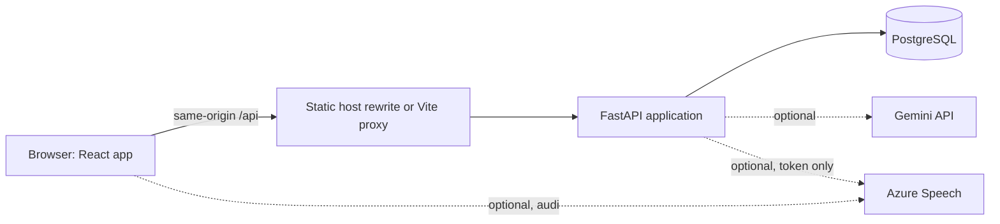

# Architecture

## Components

- The browser always calls `/api/...` on its own origin. In development Vite forwards it to
  `localhost:8000`; in production the static host rewrites it to the backend. This keeps the
  refresh cookie first-party and avoids cross-site cookie rules.
- The backend is one process. Background jobs (reminders, offer expiry, transcript purge)
  run inside it on a timer.
- Audio goes from the browser straight to Azure Speech using a short-lived token issued by
  the backend. CareBridge never receives or stores audio.

## Backend layers

| Layer | Folder | Rule |
|---|---|---|
| HTTP | `app/api` | Parse input, call a service, wrap the result. No business rules |
| Services | `app/services` | All rules and transactions. Every function that touches a patient's data checks access first |
| Integrations | `app/integrations` | One small interface per external provider, each with a `none` implementation |
| Data | `app/models.py` | SQLAlchemy models; constraints live in the database where possible |
| Core | `app/core` | Settings, sessions, password and token handling, errors, rate limits, time |

Two service modules are pure Python with no database or network access so they can be
tested in isolation: `safety.py` (emergency and medical-advice detection) and
`assistant_core.py` (the conversation state machine).

## Key flows

### Booking

1. Client sends `POST /appointments` with a slot id, patient id and an `Idempotency-Key`.
2. Access check: the caller is the patient, or a caregiver with `BOOK_APPOINTMENTS`.
3. `SELECT ... FOR UPDATE` on the slot row.
4. If the key was already used for this patient, the original appointment is returned.
   Otherwise, if the slot is not `AVAILABLE` or is in the past, respond 409
   `SLOT_UNAVAILABLE` with alternative slots.
5. Check the patient has no other active appointment overlapping that time.
6. Insert the appointment, set the slot to `BOOKED`, write audit and notifications, commit.
7. A partial unique index on `appointments(slot_id)` for active statuses is the last line of
   defence if the lock were ever bypassed.

### Waiting list

When a cancellation or reschedule frees a slot, the oldest active entry for that doctor at
that hospital receives an offer. The slot is `HELD` for 30 minutes. Accepting books it
through the normal booking path; declining or expiry passes it to the next person, and if
nobody is left the slot returns to `AVAILABLE`.

### Caregiver access

`care_relationships` moves `REQUESTED → ACTIVE → REVOKED` (or `REJECTED`). Permissions are
rows in `caregiver_permissions`; each change appends a `consent_records` row with a snapshot.
The request endpoint always answers "submitted" so it cannot be used to discover accounts.

### Assistant turn

1. Safety check on the raw text. An emergency phrase pauses booking and shows emergency
   guidance (112, 108); the only ways forward are "this is not an emergency" or starting again.
2. Extraction: the language model (if configured) returns JSON fields only; otherwise a
   rule-based extractor is used. Yes/no is always decided by rules, never by the model.
3. The state machine decides the next question or action from the collected fields.
4. Replies are built from fixed Telugu and English templates. The model never writes
   user-facing text and never calls the booking function.
5. Before booking, the server issues a confirmation token tied to one slot for five
   minutes. Only a confirm call with that token books.

### Sessions

Access token: JWT, 15 minutes, kept in browser memory only. Refresh token: random value in
an HttpOnly cookie scoped to `/api/v1/auth`, stored hashed, rotated on every use. Reuse of a
rotated token revokes the whole family. The refresh endpoint requires a custom header as a
cross-site request check.

## Deviations from the approved Phase 1 plan

| Planned | Delivered | Reason |
|---|---|---|
| TanStack Query, React Hook Form, Zod, Radix UI | Small custom hooks (`useLoad`, `useAction`) and plain elements | Fewer dependencies in code that could not be compiled or run before delivery |
| PostgreSQL enum types | String columns with constants | Simpler migrations |
| Hand-written migration | `0001` calls `Base.metadata.create_all` | Could not autogenerate without a database |
| Exclusion constraint on doctor time ranges | Unique `(doctor_id, starts_at)`; slots come from a generator with fixed lengths | No `btree_gist` dependency |
| slowapi rate limiting | In-memory limiter, per process | One process on free hosting; resets on restart |
