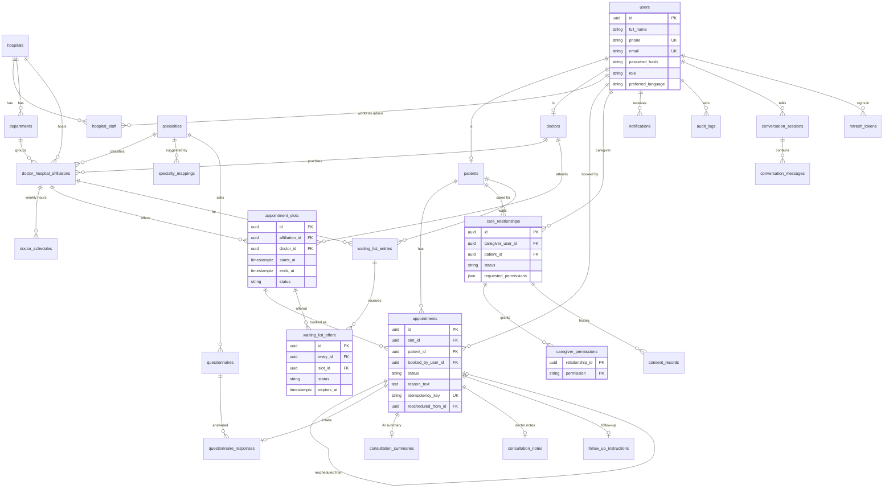

# Database design

PostgreSQL 16. 27 tables. All primary keys are UUIDs. All timestamps are `timestamptz` in
UTC. Status and role columns are strings validated by the application (not PostgreSQL enums).

## ER diagram

A rendered copy is in [er-diagram.svg](er-diagram.svg). Only the most important columns are shown.



## Tables

| Group | Table | Purpose |
|---|---|---|
| Identity | `users` | Everyone who signs in. `phone` and `email` are each unique; one of them is required |
| | `patients`, `doctors` | One-to-one role profiles |
| | `hospital_staff` | Which hospital an admin belongs to |
| | `refresh_tokens` | Hashed refresh tokens with a family id for reuse detection |
| Directory | `hospitals`, `departments`, `specialties` | Reference data. Hospitals carry `is_simulated` |
| | `doctor_hospital_affiliations` | A doctor practising in a department of a hospital, with a fee. A doctor may have several |
| | `doctor_schedules` | Weekly hours per affiliation (weekday 0 = Monday) |
| | `appointment_slots` | Concrete bookable times generated from schedules |
| Booking | `appointments` | A patient's booking of one slot |
| | `waiting_list_entries`, `waiting_list_offers` | Queue per affiliation and timed offers |
| Consent | `care_relationships` | Caregiver to patient link and its status |
| | `caregiver_permissions` | Currently granted permissions |
| | `consent_records` | Append-only history with a permission snapshot and consent text version |
| Clinical-adjacent | `specialty_mappings` | Concern phrases to department suggestions, with `review_status` |
| | `questionnaires`, `questionnaire_responses` | Pre-visit questions and the patient's answers |
| | `consultation_summaries` | AI summary of the answers, with `patient_reviewed_at` release gate |
| | `consultation_notes` | Doctor's private notes |
| | `follow_up_instructions` | Doctor's instructions the patient can read |
| Assistant | `conversation_sessions`, `conversation_messages` | Assistant state (JSONB) and transcript text |
| Cross-cutting | `notifications` | In-app notifications |
| | `audit_logs` | Who did what to which record, with request id |

## Constraints that carry business rules

| Rule | Constraint |
|---|---|
| A slot has at most one active appointment | Partial unique index on `appointments(slot_id)` where status is `PENDING` or `CONFIRMED` |
| A doctor is never in two places at once | Unique `(doctor_id, starts_at)` on `appointment_slots` |
| No duplicate slots for an affiliation | Unique `(affiliation_id, starts_at)` |
| A retried request cannot create a second booking | Unique `appointments.idempotency_key` |
| One open relationship per caregiver and patient | Partial unique index `uq_open_care_relationship` for `REQUESTED`, `ACTIVE` |
| One open waiting-list entry per patient and affiliation | Partial unique index `uq_open_waiting_entry` |
| A slot is offered to one person at a time | Partial unique index `uq_open_offer_per_slot` where status is `OPEN` |
| One intake, summary, notes and follow-up per appointment | Unique `appointment_id` on each |

Because these use partial indexes and row locks, **SQLite is not supported**, including for tests.

## Migrations

Alembic, in `backend/alembic`. There is one revision, `0001_initial_schema`, which creates
every table from the models (`Base.metadata.create_all`). This is a shortcut: it means the
first revision is not a frozen snapshot. Before changing any model after first deployment,
generate a normal revision with `alembic revision --autogenerate -m "..."` and review it.

```bash
cd backend
alembic upgrade head      # apply
alembic downgrade base    # drop everything (development only)
```

## Seed data

`python -m scripts.seed` adds 3 simulated hospitals, 8 specialties, 17 synthetic doctors
(one works at two hospitals), weekly hours, 14 days of slots, 10 concern mappings, one
questionnaire, demo accounts, one active and one pending caregiver relationship, and one
booked appointment. `--reset` deletes all application data first. It refuses to run with
`APP_ENV=production` unless `--allow-production` is given.

## Retention

Assistant transcripts older than 30 days are deleted by a background job. Nothing else is
purged automatically. There is no data export or account deletion feature (see STATUS).

## Supabase note

Supabase exposes tables in the `public` schema through its own REST API. This application
does not use that API. Run `backend/scripts/supabase_enable_rls.sql` once after migrating so
that row level security is enabled with no policies, which closes that path. The backend
connects as the database owner and is unaffected.
